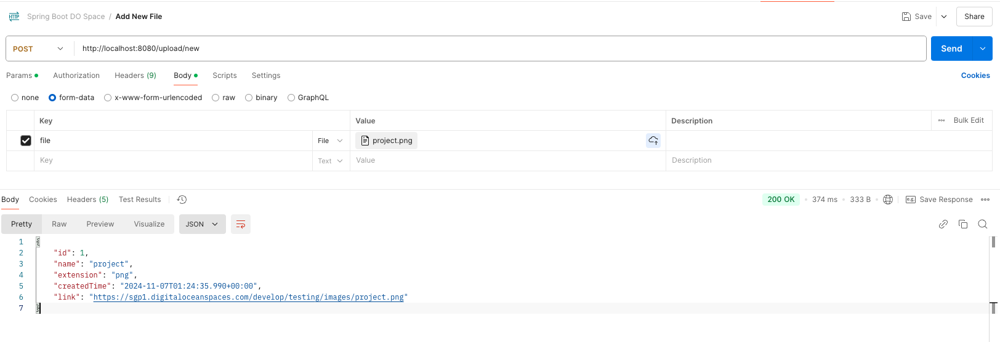
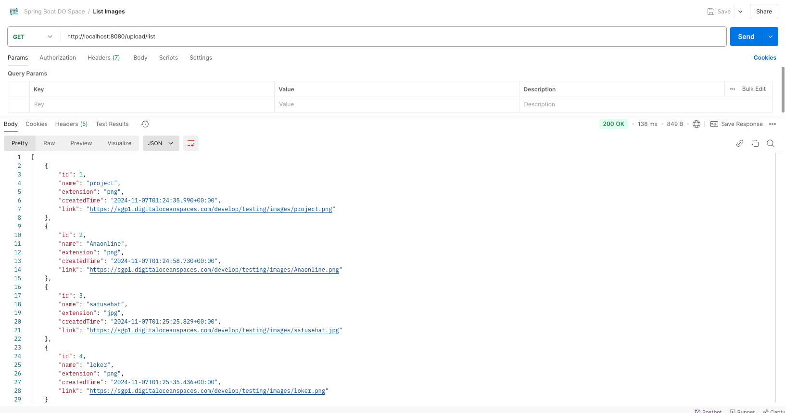
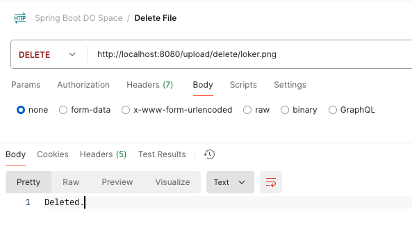

# spring-boot-digital-ocean-space

[](https://github.com/hendisantika/spring-boot-digital-ocean-space/actions/workflows/maven.yml)


Spring Boot REST API for uploading, listing and deleting images stored in
[DigitalOcean Spaces](https://www.digitalocean.com/products/spaces) (S3-compatible object storage),
with image metadata persisted in PostgreSQL.

### Tech Stack

- Java **25** (Temurin)
- Spring Boot 4.1.x (Web, Data JPA, Docker Compose, DevTools)
- AWS SDK for Java (S3) — talks to DigitalOcean Spaces
- PostgreSQL 17 + pgAdmin 4 (via Docker Compose)
- Lombok
- Testcontainers
- Maven Wrapper

### Prerequisites

- JDK 25 (`java -version` should print `25`)
- Docker & Docker Compose (PostgreSQL is started automatically by `spring-boot-docker-compose` from `compose.yml`)
- A DigitalOcean Spaces bucket and access key

### Configuration

DigitalOcean Spaces credentials are read from environment variables (see `src/main/resources/application.yml`).
**Never commit real credentials.**

| Environment variable | Description                     | Example                               |
|----------------------|---------------------------------|---------------------------------------|
| `DO_SPACE_KEY`       | Spaces access key               | `DO00XXXXXXXXXXXXXXXX`                |
| `DO_SPACE_SECRET`    | Spaces secret key               | `xxxxxxxxxxxxxxxxxxxxxxxxxxxxxxxx`    |
| `DO_SPACE_ENDPOINT`  | Spaces endpoint                 | `https://sgp1.digitaloceanspaces.com` |
| `DO_SPACE_REGIONL`   | Spaces region (as named in yml) | `sgp1`                                |
| `DO_SPACE_BUCKET`    | Bucket name                     | `my-bucket`                           |

```shell
export DO_SPACE_KEY=...
export DO_SPACE_SECRET=...
export DO_SPACE_ENDPOINT=https://sgp1.digitaloceanspaces.com
export DO_SPACE_REGIONL=sgp1
export DO_SPACE_BUCKET=my-bucket
```

### Things todo list

1. Clone this repository: `git clone https://github.com/hendisantika/spring-boot-digital-ocean-space.git`
2. Navigate to the folder: `cd spring-boot-digital-ocean-space`
3. Set the DO Space credentials as environment variables (see [Configuration](#configuration))
4. Run the application: `./mvnw clean spring-boot:run`
5. Open POSTMAN App then import POSTMAN collection file `Spring Boot DO Space.postman_collection.json`
6. Hit the API

Build & test:

```shell
./mvnw clean package
```

### Continuous Integration

GitHub Actions workflow [`.github/workflows/maven.yml`](.github/workflows/maven.yml) runs on every push / pull request
to `main` (and manually via *workflow_dispatch*):

- Builds and tests the project with **Temurin JDK 25** using the Maven Wrapper
- Uses [Testcontainers Cloud](https://testcontainers.com/cloud/) when the `TC_CLOUD_TOKEN` secret is available
- On push to `main`, submits the Maven dependency graph to GitHub to improve Dependabot alerts

### Dependabot

[`.github/dependabot.yml`](.github/dependabot.yml) keeps dependencies up to date:

| Ecosystem      | Schedule                    | Grouping                                                         |
|----------------|-----------------------------|------------------------------------------------------------------|
| Maven          | Daily, 05:00 Asia/Jakarta   | `spring-boot`, `testcontainers`, `aws-sdk`, other minor/patch    |
| GitHub Actions | Weekly (Monday)             | All actions in a single PR                                       |
| Docker Compose | Weekly (Monday)             | PostgreSQL / pgAdmin images                                      |

PRs are labeled (`dependencies`, `java`, `github_actions`, `docker`) and use conventional commit prefixes
(`chore(deps)`, `ci(deps)`, `chore(docker)`).

### API & Screenshots

Upload new Image

```shell
curl --location 'http://localhost:8080/upload/new' \
--form 'file=@"oukTU-vac/loker.png"'
```



List All images

```shell
curl --location 'http://localhost:8080/upload/list'
```



Delete Image by filename

```shell
curl --location --request DELETE 'http://localhost:8080/upload/delete/loker.png'
```


